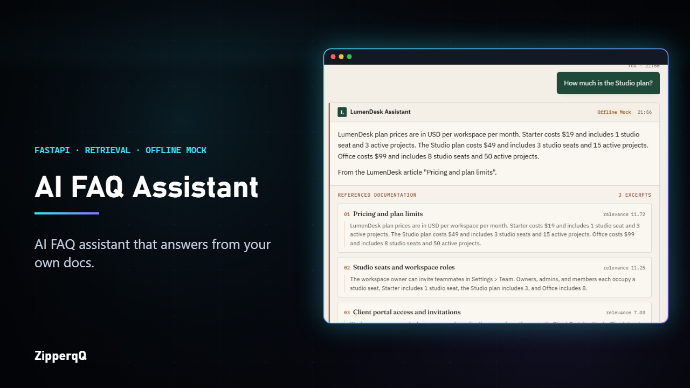
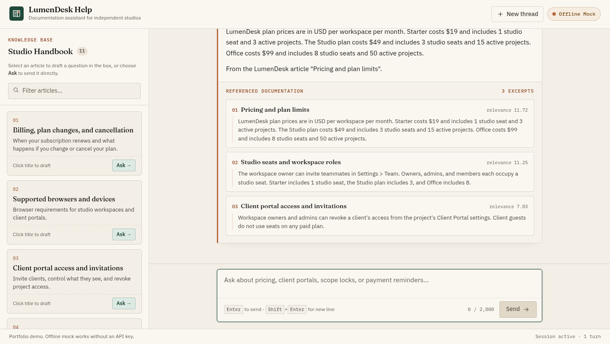

# LumenDesk FAQ Bot



A portfolio demo that answers customer questions from the docs for **LumenDesk**, a fictional SaaS product for independent studios. LumenDesk helps freelancers and small teams manage proposals, scope, client updates, and payment reminders.

## Features

- FastAPI endpoints for chat, the knowledge sidebar, and provider health.
- Lexical search across 11 bundled English handbook articles, with ranked excerpts returned alongside each answer.
- An offline mock that greets users, quotes relevant docs, and says when the docs have no answer — no API key required.
- A swappable OpenAI-compatible Chat Completions provider that receives the question, matching excerpts, and recent conversation turns.
- In-memory session history with up to 100 sessions and four completed turns per session. Restarting the server clears the history.
- A static browser UI under `frontend/`, served by the same app at `/`.

## Screenshots


Live capture of the offline mock answering "How much is the Studio plan?" with ranked handbook excerpts:



## Tech stack

- **Python 3.12+** with FastAPI, Uvicorn, Pydantic, httpx, and python-dotenv
- Vanilla HTML, CSS, and JavaScript frontend (no build step)
- Offline mock provider, or an OpenAI-compatible Chat Completions gateway
- Pytest suite that runs fully offline

## Setup

Python 3.12 is the supported version. Leave `OPENAI_API_KEY` empty to use the offline mock.

**Windows (PowerShell):**

```powershell
python --version
python -m venv .venv
.\.venv\Scripts\python.exe -m pip install -r requirements.txt
Copy-Item .env.example .env
.\.venv\Scripts\python.exe -m uvicorn app.main:app --host 127.0.0.1 --port 8000
```

**macOS / Linux:**

```bash
python3 -m venv .venv
.venv/bin/python -m pip install -r requirements.txt
cp .env.example .env
.venv/bin/python -m uvicorn app.main:app --host 127.0.0.1 --port 8000
```

The API is available at `http://127.0.0.1:8000`, the UI at `/`, and interactive API documentation at `/docs`. To use the `APP_HOST` and `APP_PORT` values from `.env` instead of passing Uvicorn flags, start the server with `python -m app.main`. Environment variables take precedence over `.env` values.

### Offline mock

Leave `OPENAI_API_KEY` empty in `.env` and in your shell environment. The mock makes no outbound requests. Try asking “How much is the Studio plan?” to see the documented $49 monthly price and its source.

### OpenAI-compatible provider

Set `OPENAI_API_KEY` privately in `.env` or your shell environment, then set `OPENAI_BASE_URL` to the gateway's API prefix and `OPENAI_MODEL` to a model supported by that gateway. For OpenAI, these default to `https://api.openai.com/v1` and `gpt-4o-mini`. The server appends `/chat/completions` to the base URL. Restart after changing settings and check `/api/health` for `openai_compat`.

## API examples

These commands use PowerShell's `Invoke-RestMethod`.

```powershell
$base = 'http://127.0.0.1:8000'
Invoke-RestMethod "$base/api/health"
Invoke-RestMethod "$base/api/knowledge"

$chat = Invoke-RestMethod "$base/api/chat" -Method Post -ContentType 'application/json' `
    -Body (@{ message = 'How much is the Studio plan?' } | ConvertTo-Json)
$chat.answer
$chat.sources

Invoke-RestMethod "$base/api/chat" -Method Post -ContentType 'application/json' `
    -Body (@{ message = 'How many seats are in the Studio plan?'; session_id = $chat.session_id } | ConvertTo-Json)
```

The same calls with `curl`:

```bash
curl -s http://127.0.0.1:8000/api/health
curl -s http://127.0.0.1:8000/api/knowledge
curl -s http://127.0.0.1:8000/api/chat -H 'Content-Type: application/json' \
  -d '{"message":"How much is the Studio plan?"}'
```

| Method and path | Success response |
| --- | --- |
| `GET /api/health` | Status and active provider name |
| `GET /api/knowledge` | `articles` with `id`, `title`, and `summary` |
| `POST /api/chat` | `answer`, ranked `sources`, `provider`, and `session_id` |

Chat accepts a `message` of 1–2,000 characters after trimming. Omit `session_id` to generate one, then pass it back to continue the same session. A supplied ID can contain up to 64 ASCII letters, digits, underscores, or hyphens.

Errors use an `error` field. HTTP `400` indicates invalid JSON or fields, `413` indicates a request body over 32 KiB, and `502` returns `upstream_unavailable` when the configured provider fails. Questions without matching excerpts receive a fallback answer and an empty `sources` array.

## Tests

```powershell
.\.venv\Scripts\python.exe -m pytest -q
```

```bash
.venv/bin/python -m pytest -q
```

The suite runs offline and isolates local settings. Provider tests use an in-memory HTTPX transport and fixture credentials.

## Frontend

The UI lives in `frontend/` (`index.html`, `css/styles.css`, `js/app.js`, and SVG assets). FastAPI serves it at `/`, assets at their corresponding paths, and the API at `/api/`. The interface includes the chat transcript, a filterable knowledge sidebar, a provider badge (Offline Mock vs live), suggested questions, and ranked source excerpts under each answer.

CORS supports `localhost` and `127.0.0.1` on ports `8000` and `5500` for local development. Restart the server after changing frontend files.

## Security

Keep `.env` out of version control and keep the API key on the server. The application uses the key in the gateway's Authorization header and keeps it out of application logs and API responses. In live mode, the gateway receives the current question, retrieved excerpts, and recent turns for the supplied session ID. Use demo data when trying the service.

## License

[MIT](LICENSE)
